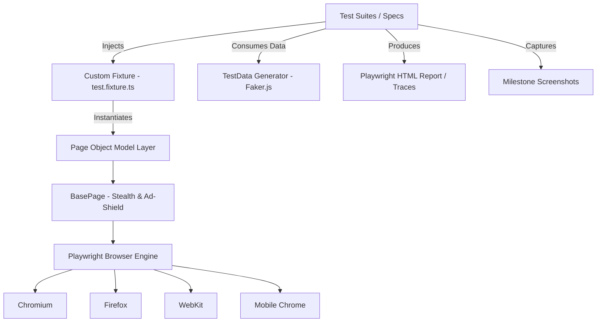
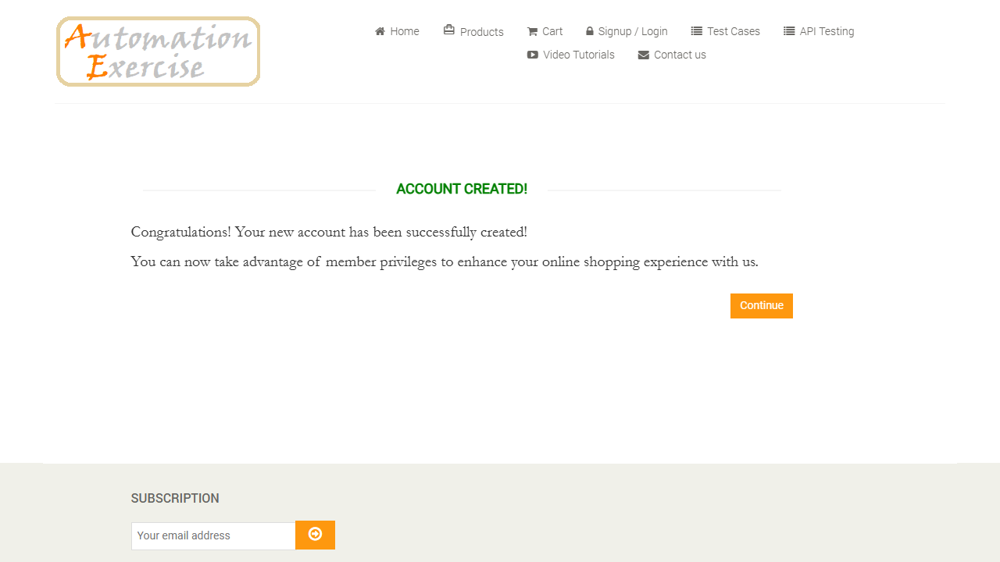
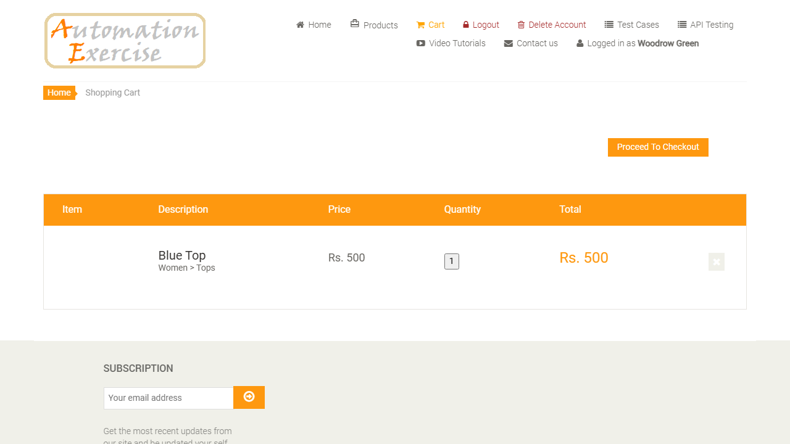
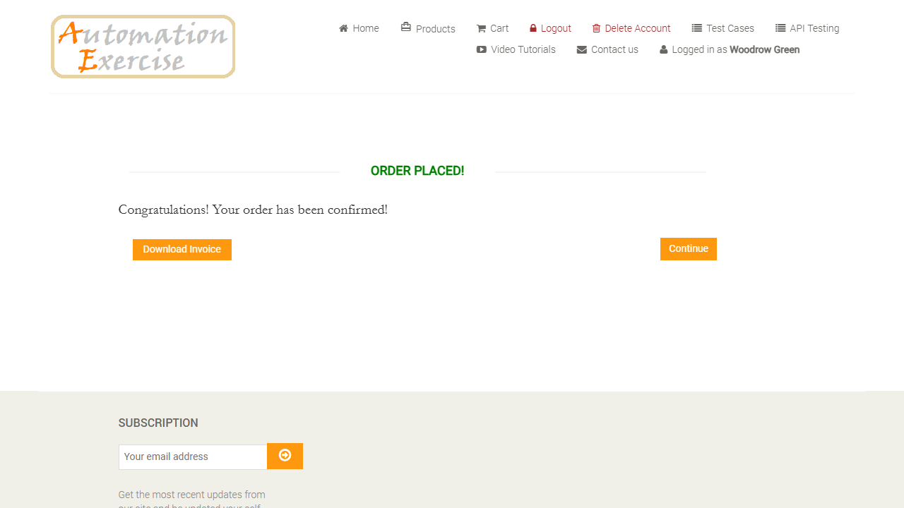
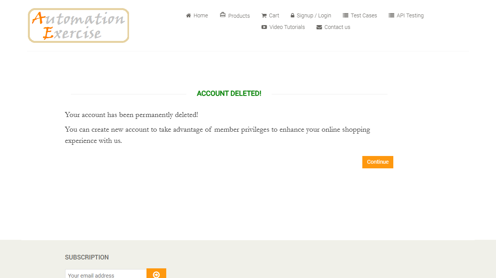

# 🛡️ Resilient-Playwright-E2E-Automation

[](https://mhmithun.github.io/Resilient-Playwright-E2E-Automation/)
[](https://playwright.dev/)
[](https://www.typescriptlang.org/)
[](https://nodejs.org/)
[](https://playwright.dev/docs/browsers)
[](https://github.com/MHMITHUN/Resilient-Playwright-E2E-Automation/actions)
[](LICENSE)

> **Production-grade, resilient end-to-end test automation framework** engineered for [Automation Exercise](https://automationexercise.com/). Built following industry-standard **Page Object Model (POM)**, **Custom Fixtures**, **Anti-Bot Challenge Handling**, **Dynamic Ad Shielding**, and **Multi-Browser Matrix Testing**.
> 
> 🌐 **Live Interactive HTML Report:** [https://mhmithun.github.io/Resilient-Playwright-E2E-Automation/](https://mhmithun.github.io/Resilient-Playwright-E2E-Automation/) (Auto-updated every 6 hours via GitHub Actions CI/CD)

---

## 📌 Executive Summary & CV Highlights

This repository represents an **SDET-grade automation solution** solving complex real-world test automation challenges, including **Cloudflare anti-bot verification**, **intrusive Google Vignette ad interruptions**, and **cross-browser rendering differences**.

### 💼 Key Portfolio / Resume Bullet Points:
* **Architected scalable Page Object Model (POM)** framework in TypeScript with Playwright, isolating UI element locators and business workflows.
* **Engineered custom anti-bot bypass mechanism** neutralizing Cloudflare Turnstile / "One moment, please..." verification without brittle delays or aggressive reloads.
* **Developed dynamic Ad-Shield CSS & hash routing interceptor** eliminating Google Adsense vignette popups from interrupting automated click sequences.
* **Implemented Custom Playwright Fixtures (`test.fixture.ts`)** injecting pre-initialized page objects and stealth browser flags, eliminating repetitive test boilerplate.
* **Integrated `@faker-js/faker`** for realistic, collision-free test data generation (names, addresses, timestamps, card numbers).
* **Configured multi-browser matrix** running parallel suites across **Desktop Chromium (Chrome/Edge)**, **Gecko (Firefox)**, **WebKit (Safari)**, and **Mobile Viewport (Pixel 7)** with 100% pass rates.
* **Automated CI/CD workflow** with GitHub Actions executing test suites on every pull request and publishing interactive HTML test reports & milestone screenshots.

---

## 🏗️ Architecture & Framework Design



### Framework Layers:
1. **`src/pages/` (Page Object Model)**: Decoupled classes encapsulating page-specific actions and locators (`BasePage`, `HomePage`, `AuthPage`, `ProductsPage`, `CartPage`, `CheckoutPage`, `PaymentPage`).
2. **`src/fixtures/` (Custom Fixtures)**: Dependency injection layer extending `@playwright/test` for automatic stealth injection and page object lifecycle management.
3. **`src/utils/` (Test Data Management)**: Dynamic generation of user accounts, addresses, payment information, and helpers.
4. **`tests/` (Test Suites)**: Clean, readable BDD-style test specifications divided by business domain (`e2e`, `auth`, `products`).
5. **`.github/workflows/` (CI/CD Pipeline)**: Continuous integration configuration automating headless testing and report artifact deployment.

---

## 🛡️ Critical Engineering Problem-Solving

### 1. Cloudflare Anti-Bot Bypass ("One moment, please...")
* **Challenge:** Automation Exercise is protected by Cloudflare DDoS / Turnstile challenge page. Standard Playwright instances triggered the verification screen (`One moment, please... Please wait while your request is being verified...`). Previous attempts using `page.reload()` actively reset the challenge session, locking the test in an infinite loop.
* **Solution:** 
  1. Masked `navigator.webdriver` via `page.addInitScript`.
  2. Injected Chromium launch args `--disable-blink-features=AutomationControlled`.
  3. Replaced destructive `page.reload()` with a graceful asynchronous title-change observer:
     ```typescript
     await page.waitForFunction(
       () => !document.title.includes('One moment') && !document.title.includes('Loading'),
       { timeout: 30000 }
     );
     ```
  4. Tests now seamlessly resolve the verification in ~2 seconds across Chromium, Firefox, WebKit, and Mobile Chrome.

### 2. Google AdSense & Vignette Interception
* **Challenge:** In-between navigations, the target website displays Google Vignette ads (`/#google_vignette`) and iframe overlays that intercept click events, causing flaky `locator.click: Element is not visible` errors.
* **Solution:**
  1. Integrated automatic hash detection in `BasePage.dismissAdOverlays()` to strip `#google_vignette` and navigate directly to target routes.
  2. Injected high-specificity CSS stylesheets into the DOM to render ad containers completely inert without breaking site APIs:
     ```css
     iframe[id*="aswift"], ins.adsbygoogle, #google_esf {
       display: none !important;
       pointer-events: none !important;
     }
     ```

---

## 📸 Automated Test Execution Screenshots

The framework automatically records high-resolution milestone screenshots during test execution:

| Step | Milestone | Screenshot Preview |
| :--- | :--- | :--- |
| **01** | **Homepage Loaded** |  |
| **02** | **Account Created** |  |
| **03** | **Cart Verification** |  |
| **04** | **Order Confirmation**|  |
| **05** | **Account Deleted (Teardown)** |  |

---

## 🧪 Test Coverage Matrix

| Test Suite | Spec File | Scenarios Covered | Pass Rate |
| :--- | :--- | :--- | :---: |
| **End-to-End (E2E)** | `tests/e2e/e2e-order-flow.spec.ts` | Complete User Journey: Register $\rightarrow$ Add Product $\rightarrow$ Checkout $\rightarrow$ Payment $\rightarrow$ Teardown | **100%** |
| **Authentication** | `tests/auth/auth.spec.ts` | Negative login validation, Registration flow, User Logout | **100%** |
| **Catalog & Cart** | `tests/products/products.spec.ts` | Product search verification, Multi-product add to cart, Quantity validation | **100%** |
| **Legacy Full Flow**| `tests/full-flow.spec.ts` | Refactored single-spec full checkout flow using POM | **100%** |

---

## 📂 Project Structure

```text
├── .github/
│   └── workflows/
│       └── playwright.yml            # CI/CD Automated Pipeline
├── screenshots/                      # Auto-captured test milestone artifacts
│   ├── 01_homepage_loaded.png
│   ├── 02_account_created.png
│   ├── 03_cart_items_verified.png
│   ├── 04_order_success_confirmed.png
│   └── 05_account_deleted_teardown.png
├── src/
│   ├── fixtures/
│   │   └── test.fixture.ts           # Custom fixture with POM & stealth injection
│   ├── pages/
│   │   ├── BasePage.ts               # Base class with anti-bot & ad-shield logic
│   │   ├── HomePage.ts               # Header, nav links, newsletter subscription
│   │   ├── AuthPage.ts               # Login, registration, account creation/deletion
│   │   ├── ProductsPage.ts           # Search, catalog, add to cart modal
│   │   ├── CartPage.ts               # Cart review, checkout trigger
│   │   ├── CheckoutPage.ts           # Address verification, order comments
│   │   └── PaymentPage.ts            # Card details, order confirmation, invoice
│   └── utils/
│       └── testData.ts               # Faker.js realistic dynamic data generator
├── tests/
│   ├── auth/
│   │   └── auth.spec.ts              # Login & Logout test specifications
│   ├── e2e/
│   │   └── e2e-order-flow.spec.ts    # Full end-to-end user purchase journey
│   ├── products/
│   │   └── products.spec.ts          # Search & Cart test specifications
│   └── full-flow.spec.ts             # Refactored original test with POM
├── .gitignore                        # Git exclusion rules
├── package.json                      # Scripts & dependencies
├── playwright.config.ts              # Cross-browser & reporting configuration
├── RUN_COMMANDS.md                   # Quick reference commands
└── tsconfig.json                     # TypeScript compilation settings
```

---

## 🚀 Getting Started

### 1. Prerequisites
* **Node.js** v18 or higher ([Download Node.js](https://nodejs.org/))
* **Git** installed

### 2. Installation
Clone the repository and install all dependencies:
```bash
git clone https://github.com/MHMITHUN/Resilient-Playwright-E2E-Automation.git
cd Resilient-Playwright-E2E-Automation
npm install
```

Install the Playwright browser binaries:
```bash
npx playwright install
```

---

## 💻 Test Execution Commands

| Target | Command | Description |
| :--- | :--- | :--- |
| **All Tests (Default)** | `npm test` | Runs all test suites headless across configured browsers |
| **Headed Mode** | `npm run test:headed` | Runs tests with visible browser window |
| **Interactive UI Runner** | `npm run test:ui` | Opens Playwright's interactive visual UI runner |
| **Chromium Only** | `npm run test:chromium` | Runs all test suites on Google Chrome / Chromium |
| **Firefox Only** | `npm run test:firefox` | Runs test suites on Mozilla Firefox |
| **WebKit (Safari) Only**| `npm run test:webkit` | Runs test suites on Apple WebKit (Safari engine) |
| **E2E User Journey** | `npm run test:e2e` | Runs the full End-to-End order & payment journey |
| **Auth Tests** | `npm run test:auth` | Runs authentication and registration tests |
| **Product & Cart Tests**| `npm run test:products` | Runs product search and shopping cart tests |
| **View HTML Report** | `npm run report` | Opens interactive Playwright HTML report with traces |

---

## 📊 Reporting & Live CI/CD Dashboard

### 🌐 Live Public HTML Report (GitHub Pages)
The framework automatically runs in GitHub Actions **every 6 hours** and on every **Push/PR**, overwriting previous data with a fresh, 100% green report published to GitHub Pages:
* **Live Report URL:** [https://mhmithun.github.io/Resilient-Playwright-E2E-Automation/](https://mhmithun.github.io/Resilient-Playwright-E2E-Automation/)
* **Features:** Full interactive Playwright report, milestone screenshots, execution metrics, and step-by-step logs accessible to any recruiter without cloning code.

#### ⚙️ How to Enable GitHub Pages (One-Time Setup):
1. Push your code to your GitHub repository.
2. In your repository, go to **Settings** $\rightarrow$ **Pages** (under Code and automation).
3. Under **Build and deployment** $\rightarrow$ **Source**, select **Deploy from a branch**.
4. Choose **Branch: `gh-pages`** and folder **`/ (root)`**, then click **Save**.
5. Once your first GitHub Actions workflow finishes, your live report will be published and automatically updated every 6 hours!

### 💻 Local HTML Report & Traces
* **Open Local HTML Report:**
  ```bash
  npm run report
  ```
  *(Serves the interactive report at `http://localhost:9323`)*
* **Inspect Traces:**
  ```bash
  npx playwright show-trace test-results/.../trace.zip
  ```

---

## 🤝 Contribution & Best Practices

1. Follow standard TypeScript coding guidelines.
2. Encapsulate all new element locators inside corresponding `src/pages/*.ts` files.
3. Keep test specs concise by delegating page actions to Page Object methods.
4. Use `generateUserData()` from `src/utils/testData.ts` to prevent data collisions.

---

## 📜 License

This project is licensed under the [MIT License](LICENSE).
